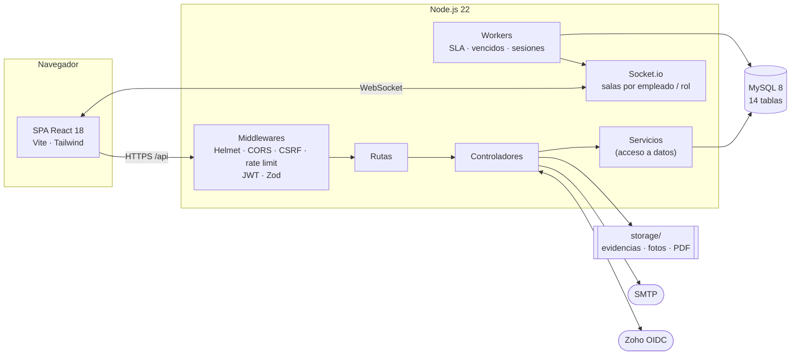
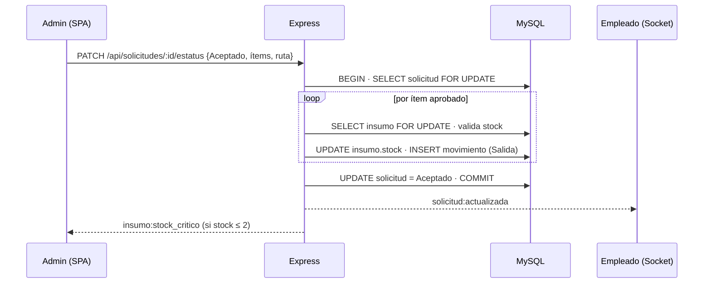
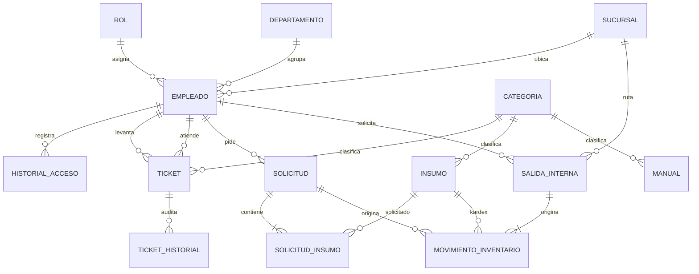

<p align="center">
  
</p>

<h1 align="center">Mesa de Ayuda · Precision Truck Parts</h1>

<p align="center">
  Plataforma interna de soporte técnico, solicitudes de insumos y control de inventario<br>
  para <b>Precision Truck Parts, Parts and Accesories, S.A. de C.V.</b>
</p>

<p align="center">
  
  
  
  
  
  
  
</p>

---

## Contenido

1. [Resumen](#1-resumen)
2. [Funcionalidad](#2-funcionalidad)
3. [Arquitectura](#3-arquitectura)
4. [Modelo de datos](#4-modelo-de-datos)
5. [Decisiones de diseño](#5-decisiones-de-diseño)
6. [Seguridad](#6-seguridad)
7. [Estructura del repositorio](#7-estructura-del-repositorio)
8. [Instalación y desarrollo](#8-instalación-y-desarrollo)
9. [Configuración](#9-configuración)
10. [Despliegue en producción](#10-despliegue-en-producción)
11. [Operación y respaldos](#11-operación-y-respaldos)
12. [Convenciones](#12-convenciones)
13. [Solución de problemas](#13-solución-de-problemas)
14. [Documentación técnica](#14-documentación-técnica)

---

## 1. Resumen

Los empleados de las sucursales y CEDIS reportan fallas de cómputo y solicitan
insumos; el área de Soporte Técnico los atiende desde un solo sistema; la
administración controla el inventario con trazabilidad completa (kardex) y
consulta manuales, historial y métricas. Los cambios se notifican en tiempo real.

| Indicador | Valor |
|---|---|
| Arquitectura | Monolito cliente-servidor: SPA React + API REST Express + MySQL |
| API | 73 endpoints en 5 módulos (`auth`, `tickets`, `solicitudes`, `manuales`, `categorias`) |
| Base de datos | 14 tablas normalizadas, 29 llaves foráneas, InnoDB, `utf8mb4_unicode_ci` |
| Tiempo real | Socket.io con salas por empleado y por rol |
| Tareas programadas | SLA de tickets (30 min), cierre de vencidos (1 h), sesiones huérfanas (1 h) |
| Usuarios | ~100 empleados activos en 16 sucursales / CEDIS |

---

## 2. Funcionalidad

| Módulo | Capacidades |
|---|---|
| **Tickets** `ST-AAAAMM-NNNN` | Alta con categoría, prioridad y hasta 8 evidencias (imagen o video, validadas por contenido). Estados *En proceso → Resuelto / No Resuelto / Cancelado*, asignación de técnico, comentarios, calificación de 1 a 5, historial de cambios por campo y cierre automático a las 48 h con alertas previas. |
| **Solicitudes de insumos** `SOL-AAAAMM-NNNN` | El empleado arma su pedido sin ver existencias. El administrador aprueba o niega cada renglón, ajusta cantidades, define la ruta del material (sucursal origen → destino) y acepta: el stock se descuenta en la misma transacción. |
| **Salidas internas** `SAL-AAAAMM-NNNN` | Entregas sin solicitud con solicitante, responsable, ruta, prioridad y justificación; hoja imprimible con firmas. |
| **Inventario / kardex** | Entradas, salidas y ajustes con `stock_anterior → stock_nuevo`. Las entradas son editables y la diferencia se propaga al stock y al kardex posterior. Baja lógica y visibilidad pública por insumo. |
| **Manuales técnicos** | PDF por categoría, portada generada en el navegador (pdf.js), búsqueda, visor integrado y carga por lote. |
| **Personal** | Altas, edición, baja lógica, historial de accesos imprimible. |
| **Autenticación** | Correo y contraseña o **Zoho SSO** (OIDC). Recuperación por código enviado al correo. |
| **Reportes** | Exportación a Excel y hojas imprimibles (tickets, solicitudes, salidas, inventario, kardex). |

**Roles**

| Rol | Alcance |
|---|---|
| Usuario | Crea tickets y solicitudes; consulta solo lo propio; manuales. No ve existencias. |
| Soporte Técnico *(departamento)* | Lo anterior + observaciones y ruta del material en solicitudes. |
| Administrador | Operación completa: tickets, solicitudes, inventario, personal, manuales, reportes. |

---

## 3. Arquitectura



- **Un solo origen.** En producción Express sirve el frontend compilado (`dist/`),
  la API (`/api`), los archivos (`/storage`) y Socket.io desde el mismo dominio:
  sin CORS entre cliente y servidor. En desarrollo el proxy de Vite replica ese
  comportamiento.
- **Capas del backend:** `routes` (rutas y permisos) → `controllers` (reglas de
  negocio y transacciones) → `services` (consultas SQL). Los middlewares aplican
  autenticación, autorización, validación y seguridad antes de llegar al controlador.
- **Tiempo real:** cada socket se autentica con el mismo JWT (incluida la versión
  de sesión) y se une a `empleado_{id}` y, si es administrador, a `admins`.

**Flujo de una solicitud aceptada**



---

## 4. Modelo de datos



| Invariante | Cómo se garantiza |
|---|---|
| `insumo.stock = Σ entradas − Σ salidas − Σ ajustes` | Todo cambio de stock escribe su movimiento en la **misma transacción**, con bloqueo `SELECT … FOR UPDATE` sobre el insumo. |
| Kardex encadenado: cada movimiento inicia donde terminó el anterior | La edición de entradas desplaza `stock_anterior/stock_nuevo` de los movimientos posteriores y rechaza cambios que dejarían el inventario negativo. |
| Folios únicos y consecutivos por mes | Generación con bloqueo `FOR UPDATE` dentro de la transacción + índice `UNIQUE`. |
| Historial inmutable | `movimiento_inventario` usa `ON DELETE RESTRICT`: un insumo con movimientos no se puede borrar (solo inhabilitar). |
| Sin datos derivados duplicados | Puesto, sucursal y número de empleado del solicitante se obtienen por `JOIN`; no se copian a las salidas (3FN). |

Detalle de tablas, índices y la reestructura de noviembre 2026 en
[docs/database.md](docs/database.md).

---

## 5. Decisiones de diseño

| Decisión | Motivo | Alternativa descartada |
|---|---|---|
| **Revocación de JWT por `token_version`** en `empleado` | Cerrar sesión invalida todos los tokens del usuario sin lista negra; sobrevive a reinicios y escala a varias instancias. | Lista negra en memoria (se pierde al reiniciar). |
| **Transacciones con bloqueo de fila** en todo movimiento de stock | Dos administradores aceptando a la vez no pueden descontar el mismo stock. | Validar y actualizar en consultas separadas (condición de carrera). |
| **Tabla `salida_interna`** como cabecera de las salidas | Antes los datos de la salida (folio, ruta, solicitante…) se concatenaban en el texto `motivo` de cada renglón: no se podía filtrar, validar ni relacionar. | Texto estructurado dentro de `motivo`. |
| **Permisos de Soporte Técnico por nombre de departamento** | El id cambia al renumerar o reimportar; el nombre es estable. | Id fijo en código. |
| **Escala tipográfica en px** (`utils/tipografia.js`, 7 niveles) | La base `rem` del proyecto es fluida (10–12.5 px) y hacía que el texto variara entre pantallas. | Tamaños en `rem`. |
| **Portadas de PDF en el navegador** (pdf.js) | Elimina la dependencia nativa `canvas` del servidor y el procesamiento en el backend. | Generación en servidor. |
| **Monolito de un solo proceso** | Socket.io y los workers asumen una instancia; el volumen (~100 usuarios) no justifica escalar horizontalmente. | Microservicios / varias instancias con Redis. |

---

## 6. Seguridad

| Capa | Control |
|---|---|
| Transporte | HTTPS con certificado automático y HSTS (Caddy). Node escucha solo en `127.0.0.1`. |
| Autenticación | bcrypt (12 rondas), JWT de 12 h con `token_version`, SSO Zoho con `state` en cookie `httpOnly`, bloqueo por intentos. |
| Autorización | Verificada en el servidor en cada ruta (`requireAuth`, `requireAdmin`, `requireSoporteOAdmin`, `requireOwnerOrAdmin`); el usuario solo accede a sus propios recursos. |
| Entrada | Validación con Zod, consultas parametrizadas (sin inyección SQL), límites de tamaño. |
| Navegador | Helmet (CSP estricta, `nosniff`, `Referrer-Policy`), CORS de un solo origen, CSRF por cabecera obligatoria. |
| Archivos | Tipo validado por contenido (`file-type`), nombres aleatorios, protección contra *path traversal*. |
| Base de datos | Usuario de la aplicación con permisos mínimos (sin DDL), pool acotado. |
| Errores | En producción no se expone información interna. |

Política completa, riesgos aceptados e incidente de credenciales en
[docs/security.md](docs/security.md).

---

## 7. Estructura del repositorio

```
├── client/                      Frontend (React 18 + Vite 6)
│   ├── public/assets/img/       Logos e imágenes estáticas
│   └── src/
│       ├── pages/               Pantallas: Admin/, Usuario/, print/ (hojas imprimibles), Login
│       ├── components/          Modales, filtros, paginación, LogoModal, vistas de impresión
│       ├── context/             Tema claro/oscuro y notificaciones (toast)
│       ├── hooks/               Socket, auto-refresco, portadas PDF
│       ├── services/            Cliente HTTP (apiFetch) y utilidades de datos
│       └── utils/               tipografia.js, design-system.js, sesión, validaciones
├── server/                      Backend (Express 5)
│   ├── routes/                  Rutas y permisos (sin lógica de negocio)
│   ├── controllers/             Reglas de negocio y transacciones
│   ├── services/                Acceso a datos (SQL parametrizado)
│   ├── middlewares/             Auth, validación Zod, seguridad, subida de archivos
│   ├── workers/                 Tareas programadas
│   ├── config/                  MySQL, correo, caché, Socket.io
│   └── server.js                Punto de entrada
├── database/                    schema.sql (estructura) · datos-iniciales.sql (catálogos)
├── deploy/                      Servidor de producción: instalación, Caddy, PM2, respaldos
├── docs/                        Documentación técnica
└── storage/                     Archivos subidos (fuera de git)
```

---

## 8. Instalación y desarrollo

**Requisitos:** Node.js 22 LTS · npm 10 · MySQL 8.

```bash
git clone https://github.com/Matthew-Garay/Precision-Truck-Parts---Help-Desk.git
cd Precision-Truck-Parts---Help-Desk
npm install                       # npm workspaces: server/ y client/
cp server/.env.example server/.env
```

**Base de datos** — una de las dos opciones:

```bash
# A) Restaurar un respaldo existente
mysql -u root -p -e "CREATE DATABASE precision_helpdesk CHARACTER SET utf8mb4 COLLATE utf8mb4_unicode_ci"
mysql -u root -p precision_helpdesk < backups/respaldo_AAAAMMDD_HHMM/base_datos.sql

# B) Instalación nueva (incluye instrucciones para el primer administrador)
mysql -u root -p < database/schema.sql
mysql -u root -p precision_helpdesk < database/datos-iniciales.sql
```

**Arranque**

```bash
npm run all          # backend :3001 + frontend :5173  →  http://localhost:5173
```

| Script | Descripción |
|---|---|
| `npm run all` | Desarrollo: libera los puertos 3001/5173 y levanta backend y frontend. |
| `npm run build` | Compila el frontend a `dist/`. |
| `npm run server` | Producción: sirve `dist/` y la API (`NODE_ENV=production`). |
| `npm run respaldar` | Respaldo de base de datos y archivos en `backups/`. |
| `npm run probar:correo` | Prueba la configuración SMTP. |

**Verificación antes de integrar cambios**

```bash
npm run build                                       # el frontend compila
node --check server/server.js                       # sintaxis del backend
npx knip --include files,dependencies               # sin archivos ni dependencias sin uso
npm audit --omit=dev                                # dependencias de producción
```

---

## 9. Configuración

Todas las variables se documentan en [`server/.env.example`](server/.env.example).

| Grupo | Variables | Notas |
|---|---|---|
| Servidor | `NODE_ENV`, `PORT`, `HOST`, `APP_URL`, `CORS_ORIGIN` | En producción `HOST=127.0.0.1` y `APP_URL = CORS_ORIGIN`. |
| Sesión | `JWT_SECRET` | Mínimo 32 caracteres (el servidor no arranca con menos en producción). |
| MySQL | `DB_HOST`, `DB_PORT`, `DB_USER`, `DB_PASSWORD`, `DB_NAME`, `DB_SSL`, `DB_POOL_SIZE` | Usuario propio, nunca `root` en producción. |
| Correo | `SMTP_HOST`, `SMTP_PORT`, `SMTP_USER`, `SMTP_PASS`, `SMTP_FROM` | Opcional; sin él no se envían correos. |
| Zoho SSO | `ZOHO_CLIENT_ID`, `ZOHO_CLIENT_SECRET`, `ZOHO_REDIRECT_URIS`, … | Las URIs deben coincidir con las registradas en la consola de Zoho. |

---

## 10. Despliegue en producción

Opción documentada **sin costo**: VM *Always Free* de Oracle Cloud + subdominio
DuckDNS + HTTPS automático con Caddy + PM2. Guía paso a paso, verificación y
actualización de versiones en [docs/despliegue.md](docs/despliegue.md).

```
Internet ──HTTPS──▶ Caddy :443 ──▶ Node 127.0.0.1:3001 ──▶ MySQL :3306
```

| Archivo | Propósito |
|---|---|
| [`deploy/instalar-servidor.sh`](deploy/instalar-servidor.sh) | Aprovisiona Ubuntu: Node 22, MySQL 8, Caddy, PM2, firewall. |
| [`deploy/mysql-usuario.sql`](deploy/mysql-usuario.sql) | Usuario de base de datos con permisos mínimos. |
| [`deploy/Caddyfile`](deploy/Caddyfile) | Proxy inverso con certificado automático. |
| [`deploy/ecosystem.config.cjs`](deploy/ecosystem.config.cjs) | Proceso administrado por PM2 con reinicio automático. |
| [`deploy/respaldar.sh`](deploy/respaldar.sh) | Respaldo diario con retención de 14 días. |

---

## 11. Operación y respaldos

- **Respaldo:** `npm run respaldar` (Windows) o `deploy/respaldar.sh` (Linux)
  generan `Backups/respaldo_AAAAMMDD_HHMM/` con la base de datos y `storage/`.
  En Windows corre solo cada día a las 23:00 (tarea programada `HelpDesk-Respaldo`).
- **Errores:** se guardan en `logs/errores-AAAA-MM-DD.log` (30 días).
- **Pruebas:** `npm test` (base aparte `precision_helpdesk_test`; ver
  [docs/operations.md](docs/operations.md)).
- **Revisión de código:** `npm run lint` (ESLint; debe quedar en 0 errores).
- **Restauración:** `restaurar.ps1` recupera en una base nueva sin tocar la actual
  ([docs/operations.md](docs/operations.md)).
- **Salud:** `GET /api/ping` (público) y `GET /api/health` (autenticado: memoria,
  conexiones del pool y tiempo activo).
- **Cambios de esquema:** se prueban primero sobre una copia restaurada y después
  se regenera `database/schema.sql`.

---

## 12. Convenciones

| Ámbito | Regla |
|---|---|
| Commits | [Conventional Commits](https://www.conventionalcommits.org/es/): `tipo(módulo): descripción` — `feat`, `fix`, `refactor`, `docs`, `chore`, `perf`, `style`. |
| Código | Cabecera JSDoc en cada archivo (`@module`, `@requires`, `@exports`); UTF-8 sin BOM. |
| Backend | Las rutas no contienen lógica; toda operación de stock va en transacción con bloqueo. |
| Frontend | Tamaños de letra con los tokens `FS` de `utils/tipografia.js`; modales con `<LogoModal />`; paginación con `<Paginacion />`. |
| Datos | Nombres de empleados en formato título (normalizado en la validación). |

---

## 13. Solución de problemas

| Síntoma | Causa | Solución |
|---|---|---|
| `Ruta no encontrada` tras actualizar | El backend sigue con la versión anterior | Reiniciar (`Ctrl + C` y `npm run all`). |
| `DB ❌ MySQL sin conexión` | Servicio detenido o credenciales | Revisar MySQL y `DB_*` en `server/.env`. |
| No llegan correos | Variable o contraseña | Usar `SMTP_PASS` con contraseña de aplicación; `npm run probar:correo`. |
| Login con Zoho falla | URI no registrada | Registrar la URI exacta de `ZOHO_REDIRECT_URIS` en Zoho. |
| Un insumo no aparece al solicitar | Inhabilitado o sin existencia | Los usuarios solo ven insumos activos con stock. |
| PDF sin portada | Caché del navegador | Recargar con `Ctrl + F5`; verificar el archivo en `storage/Manuales/`. |

---

## 14. Documentación técnica

| Documento | Contenido |
|---|---|
| [docs/architecture.md](docs/architecture.md) | Requisitos, matriz de roles y tiempo real. |
| [docs/api-routes.md](docs/api-routes.md) | Contrato de la API: endpoints, permisos, límites y ejemplos. |
| [docs/database.md](docs/database.md) | Tablas, índices, relaciones y folios. |
| [docs/security.md](docs/security.md) | Modelo de seguridad, riesgos e incidentes. |
| [docs/despliegue.md](docs/despliegue.md) | Publicación en internet y lista de verificación. |
| [docs/operations.md](docs/operations.md) | Respaldos, restauración y mantenimiento. |

---

<p align="center">
  Desarrollado por <b>Matthew Garay</b> · Departamento de Tecnologías de la Información<br>
  Precision Truck Parts, Parts and Accesories, S.A. de C.V. · Uso interno
</p>
