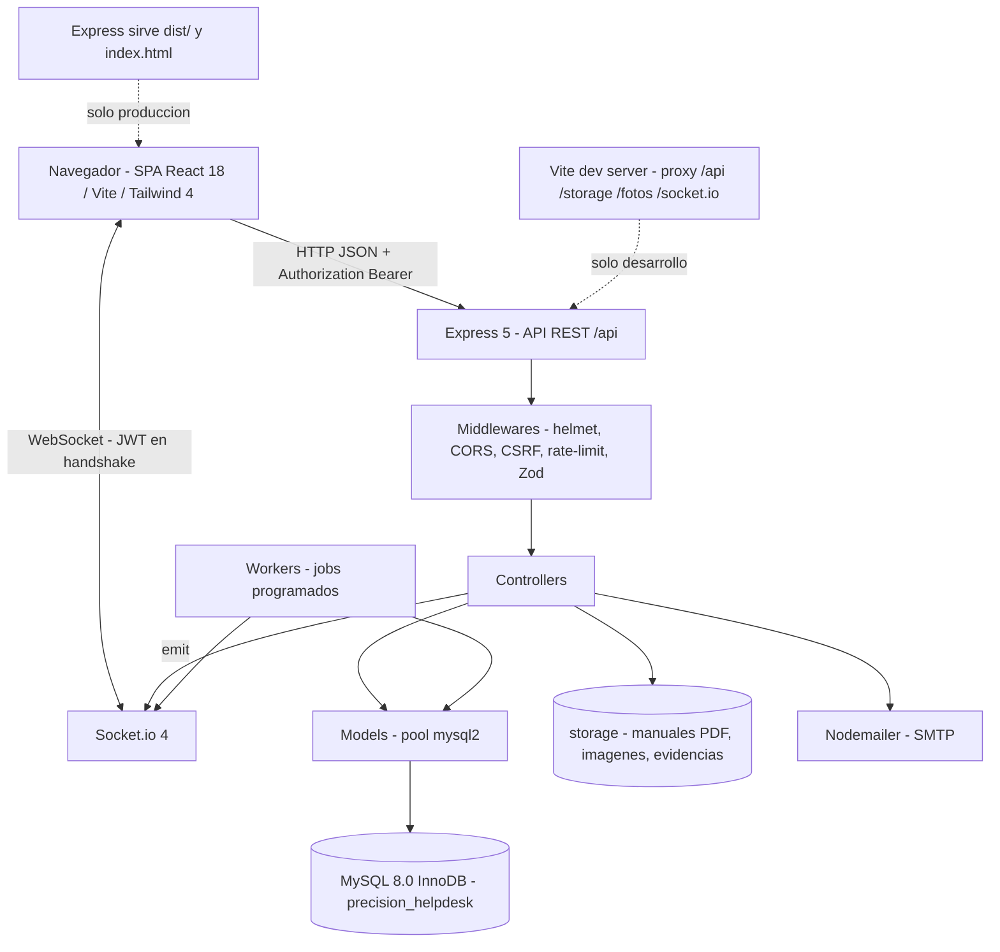

# Arquitectura y requisitos

Sistema: Mesa de Ayuda y gestion de activos (ITAM) para el departamento de Tecnologias de la Informacion de Refividrio (RFV Truck Parts and Accessories, division Precision Truck Parts, Parts and Accesories, S.A de C.V.).

## Problema operativo

Las incidencias que surgen en las 16 sucursales y CEDIS de la compania (CEDIS Puebla, CEDIS Huitzila, CEDIS Veracruz, CEDIS Monterrey, CEDIS Villahermosa, entre otras) se reciben por canales informales: llamadas telefonicas y mensajeria instantanea. Consecuencias documentadas en el proyecto de residencia:

- No hay registro ordenado ni auditable de los casos; no existe seguimiento formal.
- El equipo de TI se satura con trabajo sin prioridades claras; tiempos de respuesta altos y downtime en areas criticas (facturacion, embarques).
- No hay inventario digitalizado de activos: sin visibilidad de equipos, sin programacion de mantenimientos preventivos ni trazabilidad de recursos en CEDIS foraneos.
- Las decisiones gerenciales se toman con datos empiricos, no con metricas.

## Alcance del sistema

| Bloque | Contenido |
| --- | --- |
| Gestion de carga de trabajo | Tickets con folio PTP-YYYYMMDD-NNNN, asignacion a tecnico, priorizacion, SLA de 48 h con cierre automatico, calificacion 1-5 |
| Modulo de activos (ITAM) | Insumos con stock, categoria, estado, numero de serie, entradas/salidas con kardex (movimiento_inventario), sucursales de origen/destino |
| Repositorio de conocimiento | Manuales PDF por categoria, evidencias fotograficas de tickets |
| Panel de metricas | Dashboards de volumen de incidencias, promedio de resolucion, rendimiento de tecnicos, reportes exportables por rango de fechas |

Fuera de alcance (limitaciones del proyecto): despliegue en servidor dedicado pendiente por adquisicion de infraestructura; validaciones actuales en entorno local y red compartida.

## Roles y matriz de accesos

La tabla `rol` solo contiene dos valores:

| id_rol | nombre_rol |
| --- | --- |
| 1 | Administrador |
| 2 | Usuario |

El rol tecnico no existe como valor de `rol`. Se materializa de dos formas en el codigo:

- Asignacion en el ticket: `ticket.id_tecnico` (FK a `empleado`). El listado de tecnicos que se ofrece en los formularios proviene de `GET /api/tickets/admins` (empleados con rol 1 y estatus Activo).
- Departamento: `departamento.id_departamento = 2` ("Soporte Tecnico"). El middleware `requireSoporteOAdmin` permite rol Administrador o pertenencia a ese departamento. El departamento no viaja en el JWT; se consulta en base de datos en cada peticion.

Matriz de capacidades por perfil (S = permitido, N = denegado por API):

| Capacidad | Empleado (rol 2) | Tecnico (Soporte Tecnico / asignado) | Administrador (rol 1) |
| --- | --- | --- | --- |
| Login, perfil propio, cambio de contrasena | S | S | S |
| Historial de accesos propio | S | S | S |
| Historial de accesos global | N | N | S |
| Crear tickets con evidencias | S | S | S |
| Editar / cancelar tickets propios | S (dueno) | S (dueno) | S (cualquiera) |
| Calificar tickets propios (1-5) | S (dueno) | S (dueno) | N (solo dueno) |
| Consultar todos los tickets, filtros y detalle ajeno | N | N | S |
| Cambiar estatus de ticket, asignar tecnico, cerrar | N | N | S |
| Crear solicitudes de insumos | S | S | S |
| Ver y dar seguimiento a solicitudes propias | S | S | S |
| Aprobar/rechazar solicitudes, items y cantidades | N | N | S |
| Observaciones por insumo y ruta del material | N | S | S |
| Consultar insumos y movimientos propios | S | S | S |
| CRUD de inventario, entradas, salidas, reportes | N | N | S |
| Ver manuales PDF | S | S | S |
| Subir, editar y eliminar manuales | N | N | S |
| Gestion de personal (empleados) | N | N | S |
| Metricas, reportes y rendimiento de tecnicos | N | N | S |
| Notificaciones en tiempo real | S (las suyas) | S (las suyas) | S (sala admins) |

Guardas de autorizacion en el backend: `requireAuth` (JWT), `requireAdmin` (id_rol = 1), `requireSoporteOAdmin` (rol 1 o departamento 2), `requireOwnerOrAdmin` y validas de propiedad en el controlador (dueno del ticket/solicitud o admin). Detalle en [api-routes.md](api-routes.md) y [security.md](security.md).

Vistas de interfaz separadas por rol: `src/Frontend/Pages/Usuario/*` (reportes, historiales, solicitudes, manuales) y `src/Frontend/Pages/Admin/*` (dashboard, personal, inventario, rendimiento, vista de solicitud/ticket).

## Requisitos funcionales

Especificacion RF-01 a RF-25 del documento de residencia y su implementacion real:

| Codigo | Requisito | Implementacion |
| --- | --- | --- |
| RF-01 | Autenticacion de usuarios | `POST /api/auth/login`, JWT de 12 h |
| RF-02 | Cierre de sesion | `POST /api/auth/logout` (sendBeacon), incremento de `empleado.token_version` |
| RF-03 | Recuperacion de contrasena | `POST /api/auth/recuperar`, `/verificar-codigo`, `/reset-password` con codigo por correo |
| RF-04 | Gestion de perfil del empleado | `PUT /api/auth/perfil/:id`, `POST /api/auth/perfil/:id/foto` |
| RF-05 | Gestion de personal | `GET/POST/PUT /api/auth/empleados` (solo admin) |
| RF-06 | Creacion de tickets de soporte | `POST /api/tickets` (multipart, hasta 8 evidencias) |
| RF-07 | Consulta de tickets | `GET /api/tickets`, `/empleado/:id_empleado`, `/:id_ticket` |
| RF-08 | Actualizacion de estatus de tickets | `PATCH /api/tickets/:id_ticket` (admin) |
| RF-09 | Edicion de ticket por el usuario | `PUT /api/tickets/:id_ticket/editar` (solo mientras esta En proceso) |
| RF-10 | Cancelacion de ticket | `PATCH /api/tickets/:id_ticket/cancelar` (dueno o admin) |
| RF-11 | Gestion de evidencias fotograficas | `POST/DELETE /api/tickets/:id_ticket/imagenes` |
| RF-12 | Calificacion de la atencion | `PATCH /api/tickets/:id_ticket/calificar` (1-5, solo dueno) |
| RF-13 | Cierre automatico por vencimiento | Worker horario: tickets con 48 h pasan a No Resuelto |
| RF-14 | Alerta de tickets sin atender | Worker horario: evento `ticket:sin_atender` tras 24 h sin tecnico |
| RF-15 | Solicitudes de insumos | `POST /api/solicitudes` |
| RF-16 | Gestion de solicitudes de insumos | `PATCH /:id/estatus`, `/:id/items`, `/:id/ruta`, observaciones por item |
| RF-17 | Gestion de inventario | `POST/PUT/DELETE /api/solicitudes/insumos`, `/:id/entrada`, `/salidas`, `/movimientos` |
| RF-18 | Alertas de stock critico | Worker horario y evento `insumo:stock_critico` (stock <= 5) |
| RF-19 | Gestion de manuales de incidencias | `GET/POST/PUT/DELETE /api/manuales` (PDF, solo admin escribe) |
| RF-20 | Gestion de categorias | `GET /api/categorias` (flags en_tickets, en_insumos, en_manuales) |
| RF-21 | Notificaciones en tiempo real | Socket.io con JWT en el handshake y salas por rol |
| RF-22 | Historial de accesos | Tabla `historial_acceso`, `GET /api/auth/accesos` y `/accesos/:id` |
| RF-23 | Generacion de reportes | `GET /api/tickets/reporte`, `GET /api/solicitudes/reporte` (exportacion CSV/PDF en cliente) |
| RF-24 | Metricas del panel de administracion | `GET /api/tickets/metricas`, `GET /api/solicitudes/metricas` |
| RF-25 | Rendimiento de tecnicos | `GET /api/tickets/rendimiento` |

Requisitos no funcionales asociados (RNF-01 a RNF-17): autenticacion, control de acceso por roles, proteccion CSRF, seguridad en la comunicacion web, restringir CORS por origen, manejo seguro de archivos, validacion de subidas, proteccion de contrasenas, rate limiting, validacion de datos de entrada, pool de conexiones, compresion de respuestas, notificaciones en tiempo real, integridad transaccional, manejo de errores, configuracion segura y mantenibilidad. Cada uno se detalla en [security.md](security.md) y [operations.md](operations.md).

## Tiempo real: Socket.io

- El servidor HTTP de Express monta la instancia de Socket.io (`src/Backend/server.js`).
- Cada conexion debe presentar un JWT valido en `socket.handshake.auth.token`; sin token o con token invalido se rechaza la conexion.
- Salas: `empleado_{id_empleado}` para el usuario autenticado y `admins` para id_rol = 1.
- Los middlewares de Express no aplican a WebSockets: la verificacion ocurre una sola vez en el handshake.

| Evento | Destino | Origen |
| --- | --- | --- |
| `ticket:confirmado`, `ticket:nuevo` | empleado / admins | creacion de ticket |
| `ticket:actualizado`, `ticket:en_atencion` | empleado y admins | cambio de estatus o asignacion |
| `ticket:calificado` | admins | calificacion del usuario |
| `ticket:sla_warning` | admins | worker de SLA (cada 30 min, ~46.5 h de 48 h) |
| `tickets:vencidos` | admins | worker horario de cierre |
| `ticket:sin_atender` | admins | worker horario (> 24 h sin tecnico) |
| `solicitud:nueva`, `solicitud:actualizada` | admins / empleado | creacion y estatus de solicitudes |
| `insumo:stock_critico` | admins | worker horario y primera conexion del dia |
| `inventario:movimiento` | admins | entradas, salidas y altas/bajas de insumos |

Tareas programadas (`src/Backend/Workers/scheduledJobs.js`): alertas de SLA cada 30 minutos; cierre de tickets vencidos (48 h), limpieza de sesiones huerfanas de `historial_acceso` (mas de 12 h sin fecha de salida), alertas de stock critico y tickets sin atender, todas cada hora. Los intervals usan `unref()` y existe un guard de solapamiento entre ejecuciones.

## Patron cliente-servidor desacoplado

El sistema se separa en dos procesos logicos comunicados por una API REST con formato JSON:

- Cliente: SPA en React 18 con Vite 6, Tailwind CSS 4 y react-router-dom 7. El cliente no contiene reglas de negocio ni autorizacion; consume la API con el JWT en la cabecera Authorization.
- Servidor: Express 5 con pool de conexiones mysql2 a MySQL 8.0 (InnoDB, utf8mb4). Expone `/api/*`, los archivos de `storage/` y el canal Socket.io sobre el mismo servidor HTTP.
- Desarrollo: Vite escucha en el puerto 5173 y hace proxy de `/api`, `/storage`, `/fotos` y `/socket.io` hacia `http://localhost:3001`, sin configurar CORS.
- Produccion: un solo proceso Node (`npm run server`) sirve la API y el build estatico de `dist/` con fallback a `index.html`; `NODE_ENV=production` activa `trust proxy` y oculta el detalle de los errores 500.

